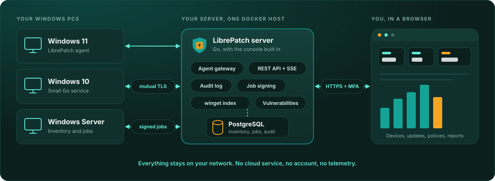
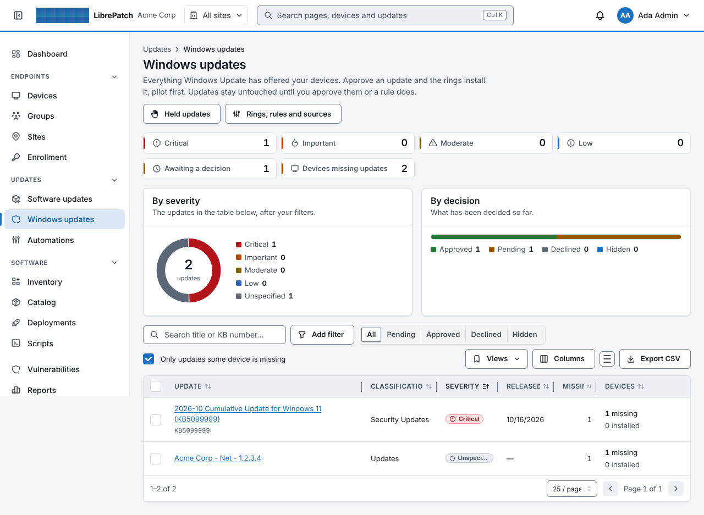
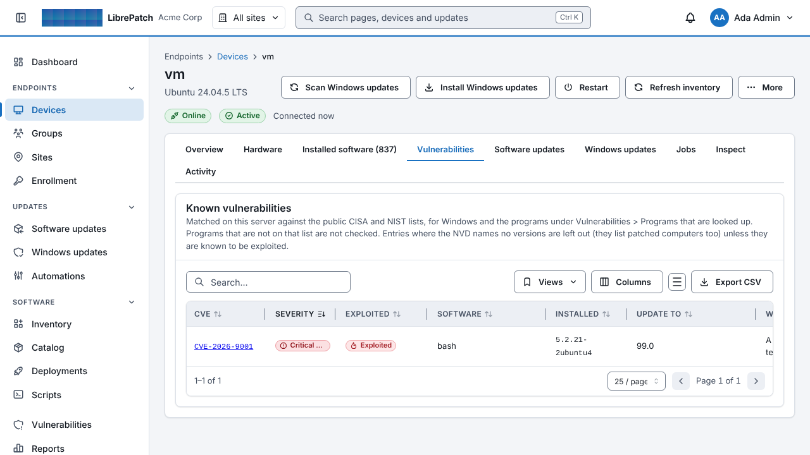
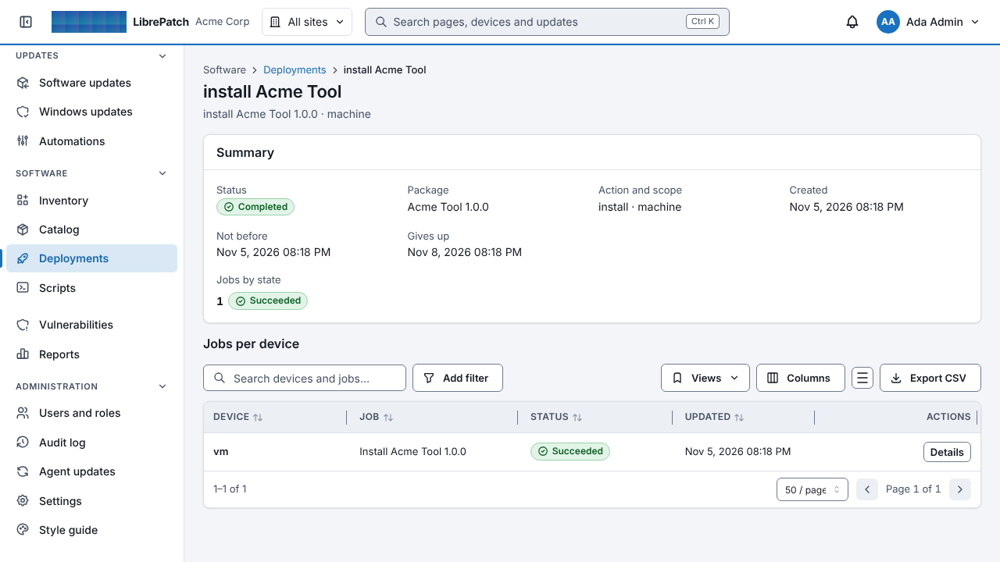

<div align="center">

<picture>
  <source media="(prefers-color-scheme: dark)" srcset="docs/brand/logo-dark.svg">
  <source media="(prefers-color-scheme: light)" srcset="docs/brand/logo-light.svg">
  
</picture>

<h3>Free, self-hosted patch and software management for Windows.</h3>

<p>
A small Go agent runs on each PC. A Go server with a REST API and a web console runs in Docker on your own hardware.<br>
Nothing leaves your network: <b>no cloud service, no account, no telemetry.</b>
</p>

<p>
<a href="https://github.com/auzring1/LibrePatch/releases"></a>
<a href="https://github.com/auzring1/LibrePatch/actions/workflows/ci.yml"></a>
<a href="LICENSE"></a>


</p>

<p>
<a href="#quick-start"><b>Quick start</b></a> &nbsp;·&nbsp;
<a href="#features">Features</a> &nbsp;·&nbsp;
<a href="#how-it-works">How it works</a> &nbsp;·&nbsp;
<a href="#documentation">Documentation</a> &nbsp;·&nbsp;
<a href="docs/THREAT-MODEL.md">Security</a> &nbsp;·&nbsp;
<a href="CONTRIBUTING.md">Contributing</a>
</p>

<br>



</div>

<br>

## Why LibrePatch

<table>
<tr>
<td width="33%" valign="top">

**🏠 Yours, end to end**<br>
Runs on your own hardware: any machine with Docker and Docker Compose (a Linux server, a VM or a NAS). Your inventory and your audit log stay on your own server.

</td>
<td width="33%" valign="top">

**🔐 Security first**<br>
Mutual TLS, jobs signed by the server and verified on the PC, mandatory two-factor sign-in with security-key support, role-based access and a hash-chained audit log.

</td>
<td width="33%" valign="top">

**🆓 Free software**<br>
Licensed under the AGPL-3.0-or-later. Use it at work, change it, and share your changes. No licensing system, no device cap.

</td>
</tr>
</table>

> [!WARNING]
> **Status: early software.** It comes with a large automated test suite (unit, database, end-to-end and browser tests), but it has
> not had an independent security audit, and several Windows-only paths (the MSI, agent self-update, restart
> handling) have had little real-world testing. It runs installers as SYSTEM on your computers, so treat it like any
> new tool with that power: read [docs/THREAT-MODEL.md](docs/THREAT-MODEL.md), pilot on a few machines first, and keep backups.

## Features

<table>
<tr>
<td width="33%" valign="top">

### 🔍 Inventory
Every installed program (machine-wide and per user), hardware, users and groups, with search and CSV export.

</td>
<td width="33%" valign="top">

### 🚀 Software updates
Finds updates for installed programs by matching them to the winget community index, so there is **no catalog to maintain**. Installs and updates from winget manifests or your own uploaded installers, with hash checks, maintenance windows and a verified/unverified safety step.

</td>
<td width="33%" valign="top">

### 🧭 Policies and rollouts
Software policies roll a new version out ring by ring and can wait for your approval first. Signed overlays record the silent arguments and verified marks you have tested.

</td>
</tr>
<tr>
<td width="33%" valign="top">

### 🪟 Windows Updates
Approval, update rings, maintenance windows, reboot policy and compliance reports.

</td>
<td width="33%" valign="top">

### 🛡️ Vulnerabilities
Matches the public CISA exploited-vulnerability list and the NIST database against Windows and the programs on your devices, entirely on your server (off until you turn it on).

</td>
<td width="33%" valign="top">

### 🔔 Alerts and lifecycle
E-mail or webhook alerts for offline PCs, failed installs, restarts that wait too long, low disk space, BitLocker off and operating systems nearing end of support, plus a report of devices that are out of support.

</td>
</tr>
<tr>
<td width="33%" valign="top">

### 🔄 Agent self-update
Rolls out through a pilot group, with automatic rollback. The server hands out the Windows agent (MSI and exe) itself, so you do not need GitHub on your network, and the console prints the install commands.

</td>
<td width="33%" valign="top">

### 🎨 Your branding
Your organization name, logos, colors and sign-in texts, five accessible themes, and encrypted backups.

</td>
<td width="33%" valign="top">

### 📦 Deploy anywhere
An MSI for deployment through GPO, Intune or an RMM.

</td>
</tr>
</table>

## Screenshots



<p>


</p>

## How it works

1. **Run the server** with Docker on a machine you own. It keeps everything in PostgreSQL and serves the web console.
2. **Enroll your PCs.** The console shows an install command; the agent connects back over mutual TLS and reports what is installed.
3. **Patch with confidence.** Approve updates, roll them out ring by ring, and watch the results. Every job is signed by the server and checked on the PC before anything runs, and every action lands in the audit log.

## Quick start

The simplest install is **one file**: download `docker-compose.yml` from the latest
[release](https://github.com/auzring1/LibrePatch/releases), set your host name in the block at its top, and start it
(`docker compose up -d`, or paste it into a new stack in a graphical container manager such as Portainer). Everything else is inside the container
images. Details: [docs/RUNBOOK.md](docs/RUNBOOK.md), section 2.2. To build from a checkout instead:
```bash
cp deploy/.env.example deploy/.env              # set LIBREPATCH_HOSTNAME (and LIBREPATCH_CADDY_TLS)
docker compose -f deploy/docker-compose.yml --env-file deploy/.env up -d --build
docker compose -f deploy/docker-compose.yml logs server | grep -A2 "setup token"
```
Passwords and the encryption key are created for you on the first start. Open `https://<LIBREPATCH_HOSTNAME>`, follow the
setup wizard, and when you first sign in the console shows the **master key**: save it somewhere other than the server. Build the Windows agent with
`GOOS=windows GOARCH=amd64 go build -trimpath -ldflags "-s -w" -o librepatch-agent.exe ./cmd/librepatch-agent`
and install it on an endpoint with the command the console shows under **Enrollment**.

- Full operations guide: [docs/RUNBOOK.md](docs/RUNBOOK.md)
- Every setting, its default, limits and who may change it: [docs/SETTINGS.md](docs/SETTINGS.md) (generated from the settings registry)
- Fresh install on Windows 11 with Docker Desktop, up to the first enrolled agent: [docs/FRESH-INSTALL-WINDOWS.md](docs/FRESH-INSTALL-WINDOWS.md)
- Try it on a throw-away Windows VM, including agent self-update and rollback: [docs/TRY-ON-A-TEST-VM.md](docs/TRY-ON-A-TEST-VM.md)

## Documentation

| Doc | |
|---|---|
| [ARCHITECTURE](docs/ARCHITECTURE.md) | Components, agent internals, install engine, user-context helper |
| [PROTOCOL](docs/PROTOCOL.md) | Enrollment, mTLS channel, signed jobs, inventory |
| [DATA_MODEL](docs/DATA_MODEL.md) | PostgreSQL schema |
| [THREAT-MODEL](docs/THREAT-MODEL.md) | Threat model, controls with evidence, known gaps |
| [RUNBOOK](docs/RUNBOOK.md) | Install, operate, troubleshoot (branding: §5g) |
| [VERIFYING_RELEASES](docs/VERIFYING_RELEASES.md) | Check a release's signatures and reproducibility |
| [LOADTEST](docs/LOADTEST.md) | Load generator and sandbox results |

**Console design:** semantic design tokens, five WCAG AA themes (Light, Slate, Dark, Midnight, High contrast) plus "follow my device", per-account preferences.

**Branding:** the organization name, product name, logos, colors and sign-in texts are configuration, not source: set them in the first-run wizard and under Settings > Branding (administrators only). The LibrePatch logo files used on this page are in [docs/brand](docs/brand/README.md).

<details>
<summary><b>Development</b></summary>

<br>

Requirements: Go 1.27 (the toolchain is pinned in `go.mod`), Node 22, Docker.
```bash
make tools                 # pinned generators and linters
make dev-db                # throwaway Postgres; prints LIBREPATCH_TEST_PG_URL to export
make web build             # console bundle, server, agent (windows + linux test build)
make test                  # unit, database and in-process end-to-end tests (race detector)
make test-gui              # Playwright: setup → MFA login → enroll a real agent → deploy a package → revoke, CSP-strict
make fuzz                  # 20 s per fuzz target over the untrusted-input parsers
make test-compose          # full docker-compose stack + real agent process
make lint vuln licenses    # vet, staticcheck, gosec, semgrep; govulncheck, npm audit; license allow-list
```
Run the web console against a local server: start the server with `LIBREPATCH_DEV_MODE=true LIBREPATCH_PUBLIC_URL=http://localhost:5173 ...`, then run `cd web && npm run dev`.

</details>

<details>
<summary><b>Repository layout</b></summary>

<br>

| Path | |
|---|---|
| `cmd/librepatch-server`, `cmd/librepatch-agent`, `cmd/librepatch-release` | Binaries (`librepatch-release` is the release-signing tool: it signs the agent releases the server hands out) |
| `cmd/librepatch-loadsim` | Load generator that simulates thousands of agents against a server (see [docs/LOADTEST.md](docs/LOADTEST.md)); a test tool, not shipped |
| `internal/server/*` | API, auth/MFA, gateway, PKI, audit, store, web UI embedding |
| `internal/agent/*` | Agent core, CNG key store, hardware collector, Windows service, installer |
| `internal/shared/*` | Protocol helpers shared by both: envelopes, enrollment bundle, PKIX conventions |
| `proto/`, `api/openapi.yaml`, `db/` | Agent protocol, REST contract, migrations and queries |
| `gen/` | Generated code (protobuf, sqlc). CI checks it is up to date |
| `web/` | React + TypeScript + Mantine console (embedded into the server binary) |
| `installer/windows` | WiX sources and build scripts for the agent MSI |
| `deploy/` | Dockerfile, compose stack, and the small web proxy (`caddy/`) and database (`postgres/`) images |
| `test/` | End-to-end, compose integration, VM matrix harness (`test/vm-matrix`), CI tools |
| `docs/` | Plan, architecture, protocol, data model, security, decisions, runbook, demos |

</details>

## Contributing, security and license

- **Contributing:** bug reports, ideas and pull requests are welcome; see [CONTRIBUTING.md](CONTRIBUTING.md).
- **Security problems:** please report them privately; see [SECURITY.md](SECURITY.md).
- **License:** Copyright © 2026 the LibrePatch contributors. LibrePatch is free software under the
  [GNU Affero General Public License v3.0 or later](LICENSE). You may use it, including at work, and change it. If you run a
  modified version for other people, or distribute a modified agent, you must make your changes available under the same
  license. The name "LibrePatch" is not part of that license: see [TRADEMARKS.md](TRADEMARKS.md).
- Third-party components and their licenses: [THIRD_PARTY_NOTICES.md](THIRD_PARTY_NOTICES.md).

<div align="center">
<br>

<br>
<sub>LibrePatch: patching other people's computers, without sending their data anywhere.</sub>
</div>
